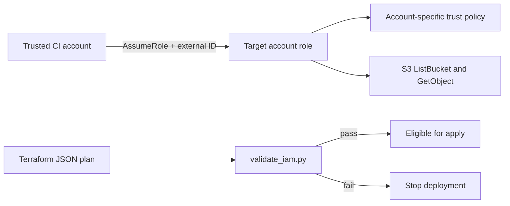

# Design document: Cross-account IAM role

## Problem

A CI account needs temporary access to resources in another AWS account. A broad trust policy or broad permissions would turn a deployment role into a security risk.

## Goal

Create a reusable read-only role with two controls: a named trusted account plus external ID in the trust policy, and a narrow S3 permission set.

## Design



- Terraform creates the role and inline policy.
- The trust policy names the trusted account root and requires `sts:ExternalId`.
- The inline policy allows only `s3:ListBucket` on named bucket ARNs and `s3:GetObject` on their object paths.
- `validate_iam.py` reads the Terraform JSON plan and rejects wildcard principals, missing external IDs, wildcard resources, and actions outside the allowlist.

## Verification

```bash
python validate_iam.py fixtures/pass-plan.json \
  --trusted-account-id 111111111111 --external-id clinic-demo-2026
python validate_iam.py fixtures/fail-plan.json \
  --trusted-account-id 111111111111 --external-id clinic-demo-2026
python -m unittest discover -s tests -v
```

The safe fixture returns `0`. The unsafe fixture returns `1` and identifies the trust and permission violations.

## Risks and limits

The external ID must be treated as a secret shared with the trusted caller. Production use should add role session constraints, CloudTrail review, an approved bucket list, and a controlled Terraform state backend.

